# Seen: a dark-mark and acne tracker for melanin-rich skin

**Live app:** <https://blackgirl-zeta.vercel.app> (open it on your phone)

Dark marks after acne (post-inflammatory hyperpigmentation) are the number one skin concern for Black women,
and most skin apps weren't built for deep skin. Seen counts every dark mark and acne spot on
**YouCam's AI Skin Analysis** detection maps, builds a cosmetic plan with real, ingredient-checked products,
and tracks the marks week by week as they fade.

Built for the YouCam API Skin AI & eCommerce VTO Hackathon (Perfect Corp).

> **Cosmetic guidance, not a diagnosis.** Seen does not diagnose any condition. See a dermatologist
> for persistent or severe concerns.

## YouCam APIs used

| API | How Seen uses it |
|---|---|
| **AI Skin Analysis (V2)** | Server-side: upload → task → bounded polling. 10 concerns per scan, **HD automatically** when the photo's short side is ≥ 1080 px. Seen uses the honest `raw_score`, not the inflated `ui_score`, and **counts the marks on YouCam's own detection masks** (connected blobs, face zones, % of face). |
| **JS Camera Kit** (skincare mode) | Guided capture: live checks for face found, distance, facing forward and light, then automatic capture. |

## Screenshots

Screens below use a sample portrait. All numbers come from real YouCam calls.

| | | |
|---|---|---|
| 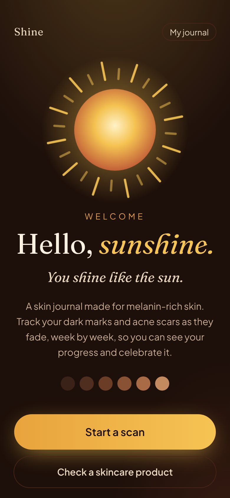 | 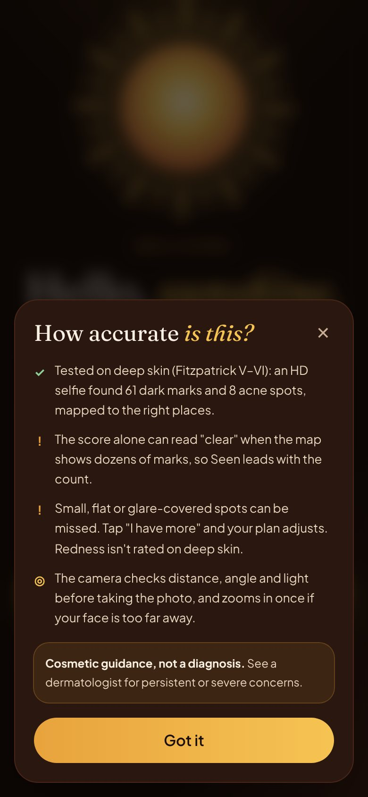 | 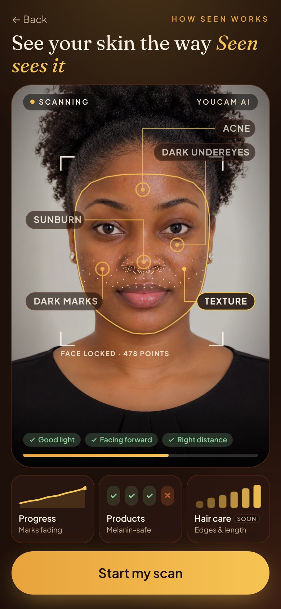 |
| 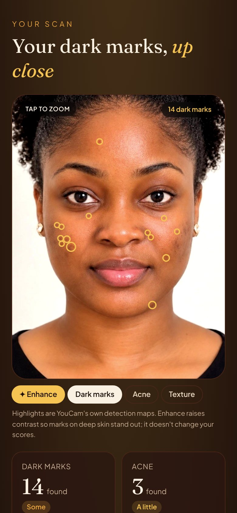 | 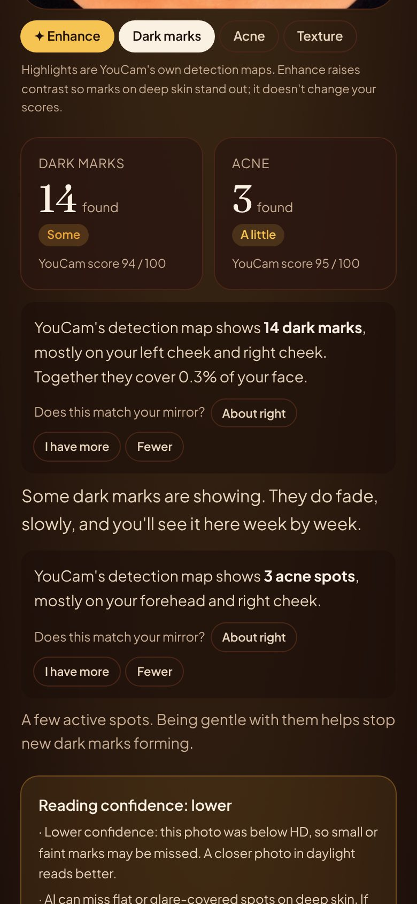 | 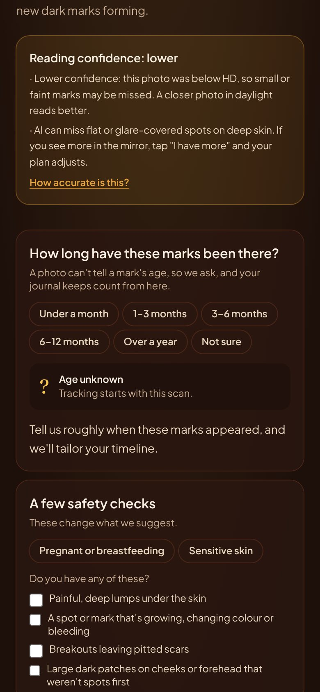 |
| 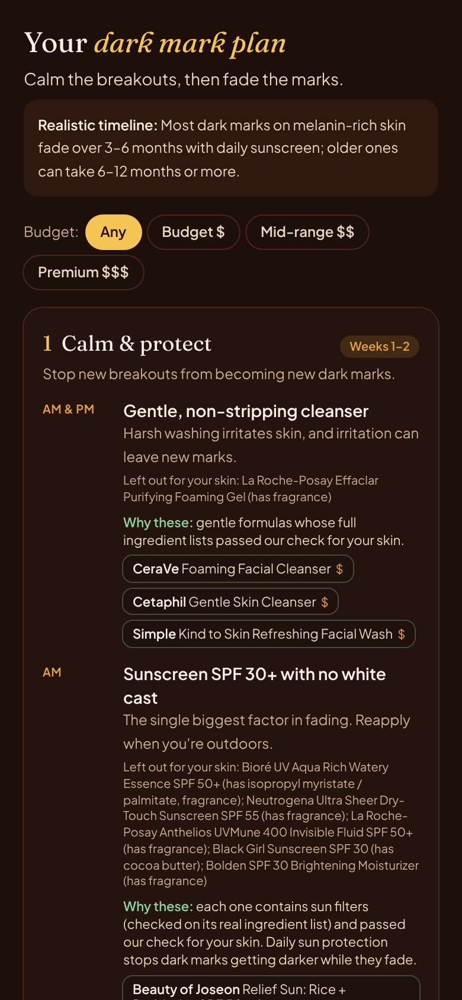 | 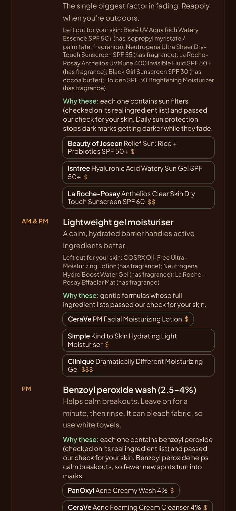 | 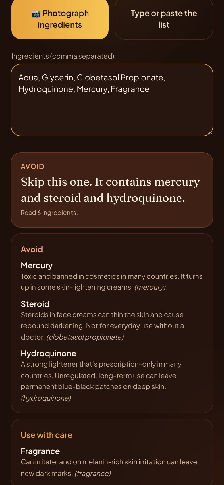 |
| 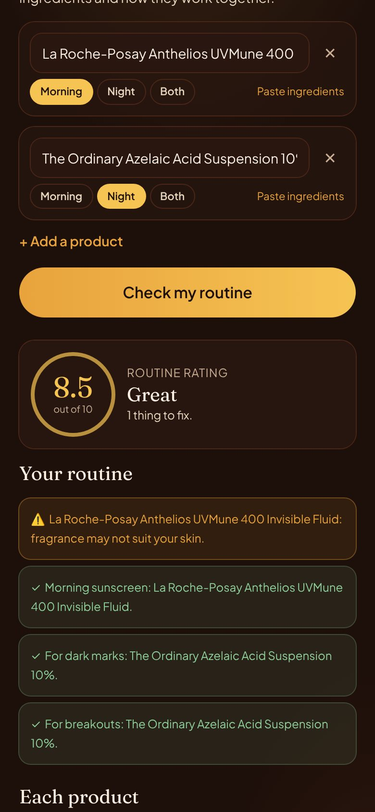 | 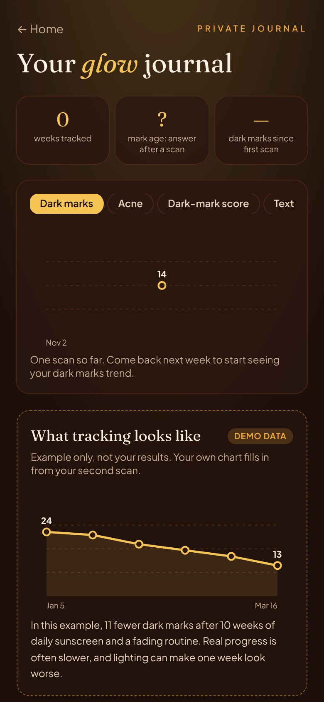 | 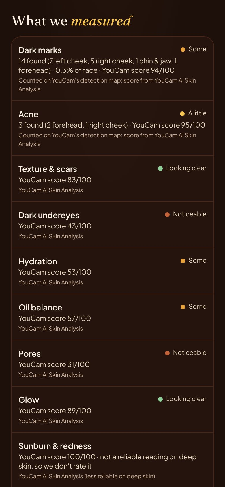 |

## What it does

1. **Guided capture:** the YouCam Camera Kit checks light, angle and distance live and takes the photo. Tips are
   written for deep skin and textured hair (face a window, pull hair back, blot shine). You can also **upload a
   photo** or use a simple backup camera.
2. **Analysis:** the server sends the photo to YouCam AI Skin Analysis. The API key never reaches the phone.
   Results are cached by image hash, so the same photo never spends credits twice.
3. **Results, led by counts:** "61 dark marks, mostly on your forehead." Each mark is ringed on the photo (tap to
   zoom). The user can answer **"Does this match your mirror?"**, and "I have more" makes the plan stronger. A
   **reading-confidence** card says when the photo was below HD or had to be zoomed.
4. **Dark mark plan:** Calm & protect → Fade → Renew, adjusted for mark age, pregnancy (no retinoids), sensitive
   skin and warning signs (dermatologist first). Every step lists real products at three price bands, with
   **"Why these"** (the key ingredient and what it does) and what was **left out for your skin** and why.
5. **Product check:** photograph an ingredient list (read on the phone with Tesseract.js) or paste it. Seen flags
   **mercury, steroids such as clobetasol, and hydroquinone** as Avoid, and pore-clogging oils and irritants as
   Use with care. It reads labels only and can't tell whether a product is genuine.
6. **My routine:** list your products for morning and night. Each one is matched to its real ingredient list and
   checked, the routine is checked as a whole (missing sunscreen, retinoid + acid on the same night, overlaps), and
   it gets a **rating out of 10**.
7. **Journal:** every scan is saved privately (anonymous Supabase account, row-level security), with a trend chart,
   a then-and-now photo slider and delete. Until there are two real scans, an example chart marked
   **"Demo data"** shows what tracking looks like; it is never mixed with real results.
8. **Daily reminders:** "Apply sunscreen" (plus an optional midday reapply) and "Drink water" every 2 or 3 hours,
   at times you choose. `GET /api/reminders` builds a calendar file of daily events with alerts, so they ring even
   when Seen is closed (a website can't send scheduled notifications on iPhone).
9. **How accurate is this?** A small in-app card (and the section below) with our deep-skin test results.

### How the assessment works (server-side)

`POST /api/assessment` (`src/lib/assessment.ts`) turns measurements into a plan:

1. **Measured:** YouCam AI Skin Analysis scores and detection maps (SD, or HD when the photo allows).
2. **Counted:** dark marks and acne spots on YouCam's own maps, with location and coverage.
3. **Your answers:** mark age, "does this match your mirror?", and safety questions (pregnant or breastfeeding
   removes retinoids; sensitive skin slows introduction; warning signs such as a changing or bleeding mark put a
   dermatologist first).
4. **Products:** each catalogue product's full ingredient list is fetched from INCIDecoder by
   `scripts/fetch-inci.mjs` into `src/data/inci.json` (with page URL and date; 49/49 verified on 2026-11-02, across
   budget, mid-range and premium price bands; users pick their budget in the plan).
   A product is recommended only if that list contains what the step needs and passes the same ingredient check
   as Product check for *this* user; otherwise it's listed as "left out for your skin" with the reason. For oily,
   acne-prone skin, for example, Black Girl Sunscreen is left out for cocoa butter and Bolden SPF 30 for fragrance.

The result is a cosmetic assessment with its working shown ("What we measured", "How Seen reached this"), not a
medical diagnosis.


### Counting marks, not just scoring them

YouCam's skin scores average over the whole face. On a real scan of a portrait with clearly
visible post-acne marks, `age_spot` scored **93.8 / 100 ("clear")**. YouCam's own detection
**mask**, however, marked every spot. So Seen counts the connected blobs on YouCam's dark-mark
and acne masks (`src/lib/youcam/marks.ts`), measures their share of the face (using the
moisture map as the face area), and places them by zone using the dark-circle map as the eye
line. The same scan reads as **14 dark marks** (7 left cheek, 4 right cheek, 2 forehead,
1 jaw), covering 0.3% of the face, plus **3 acne spots**. The count is what the journal tracks
week to week, and it drives the plan whenever it is worse than the score.

### How accurate is this? (real YouCam calls on deep skin, Fitzpatrick V–VI)

The same findings are shown in the app ("How accurate is this?" on the welcome screen and on every result).

| Photo | Dark-mark score | Dark marks counted | Acne score | Acne counted | Redness |
|---|---|---|---|---|---|
| Real deep-skin selfie, **HD** (1440×2122) | 87 "clear" | **61** (36 forehead, 10 + 9 cheeks) | 73 | **8** | **100** |
| Real deep-skin selfie (team member, 543×800, some cheek glare) | 86.6 "clear" | **44** (25 forehead, 9 + 7 cheeks) | 78.4 | **9**, *user reports more* | **100** |
| AI-generated portrait with visible cheek marks (713×951) | 93.8 "clear" | **14** (11 on cheeks) | 94.8 | 3 | **100** |
| Team member selfie (earlier test) | 86.5 | n/a | 87.2 | n/a | **100** |

What we learned:
- **Scores hide marks.** In both photos with visible marks, the dark-mark score read "clear" while YouCam's own mask
  marked 14 and 44 spots. Seen leads with the count.
- **Redness reads 100 on every deep-skin photo** we tried, so the app labels it as unreliable on melanin-rich skin.
- **Acne was under-counted** on the real selfie (the user sees more than 9). Likely causes: low resolution and glare.
  Seen now (1) switches to YouCam's **HD** analysis automatically when the photo's short side is ≥ 1080 px,
  (2) asks "Does this match your mirror?" and plans for more when the user says so, and (3) tells users to blot shine.

- **HD finds more.** The same selfie at HD found 61 dark marks against 44 at standard resolution, so Seen
  uses HD automatically and shows "Reading confidence: lower" on results from smaller or zoomed photos.

#### Capture errors we hit, and how the app prevents them

| Error | What happened | What Seen does |
|---|---|---|
| `error_src_face_too_small` | Our first phone scans failed: YouCam needs the face to fill most of the width. | The guided camera says "come a little closer"; if a photo is still too far, Seen crops to the face and retries once automatically (tested: 422 → 200). |
| `error_large_face_angle` ("turned too far") | YouCam rejects turned or tilted faces. | The guided camera's live check waits for "facing forward, chin level"; the error message tells the user to look straight at the camera. |
| Shadows and glare | Overhead light and oily shine can look like, or hide, dark marks on deep skin. | Live lighting check, plus tips to face a window and blot shine. |

#### Progress over time
The journal shows a trend chart and a then-and-now photo slider once there are two real scans. Until then it shows
an example chart marked **"Demo data"**, which is never mixed with real results.

> **Cosmetic guidance, not a diagnosis.** See a dermatologist for persistent or severe concerns.

Redness is flagged in-app as less reliable on deep skin. On our first real scan, YouCam returned
a perfect 100 for redness on deep skin.

## Setup

```bash
npm install
cp .env.example .env.local   # then add YOUCAM_API_KEY
npm run dev
```

Get an API key at <https://yce.makeupar.com/api-console/en/api-keys/>. The key is read only
on the server (`process.env.YOUCAM_API_KEY`). Never give it a `NEXT_PUBLIC_` prefix.

Without a key, `/api/analyze` responds `503` ("live analysis isn't configured"). Every result
is a real YouCam analysis.

### Tests

```bash
npm test          # parser, insight bands, ingredient picks, banned-medical-wording check
npm run verify:db # row-level security checks against your Supabase project
```

### Database (Supabase)

1. Create a Supabase project and copy the URL and publishable key into `.env.local`.
2. Turn on **Authentication → Sign In / Providers → Allow anonymous sign-ins**. Each visitor
   gets a private history without creating an account.
3. Open the **SQL Editor**, paste `supabase/migrations/001_init.sql` and run it. This creates the
   `scans` table, the private `scan-photos` bucket and row-level security, so users only see their own data.

4. Run `npm run verify:db`. It creates two anonymous users and checks that each one can only
   see and delete their own scans and photos (14 checks).

### Try the API route

```bash
npm run smoke -- ./path/to/selfie.jpg
```

The response's `source` is `live` or `cache` (same photo seen before, no units spent).

## How the YouCam integration works

`src/lib/youcam/client.ts` follows the V2 docs (<https://yce.perfectcorp.com/document/index.html>):

1. `POST /s2s/v2.0/file/skin-analysis`: register the file, which returns a `file_id` and a pre-signed URL
2. `PUT` the image bytes to that URL
3. `POST /s2s/v2.0/task/skin-analysis` with `src_file_id`, `dst_actions` and `format: "json"`
4. `GET /s2s/v2.0/task/skin-analysis/{task_id}` every 1–3 s until `success` or `error`
   (the docs say a task that isn't polled for about 10 s is dropped but still billed), with a hard 120 s cap

Concerns requested (SD needs a short side ≥ 480 px; HD `hd_*` actions are used from 1080 px): `age_spot` (YouCam's pigmentation /
spots detector, our proxy for dark marks), `acne`, `texture`, `redness`, `radiance`, `pore`,
`oiliness`, `moisture`, `dark_circle_v2` and `skin_type`.

We show `raw_score` as the main number. The docs say `ui_score` is deliberately adjusted
upward "as a psychological motivator", which isn't honest enough for tracking progress.

Results are cached by a SHA-256 of the image bytes (`.cache/youcam/`, scores only). Photos are
never written to disk by the server.

### Running inside a sandbox with an HTTPS proxy

Node's built-in `fetch` ignores `HTTPS_PROXY` unless told otherwise:

```bash
NODE_USE_ENV_PROXY=1 NODE_EXTRA_CA_CERTS=/path/to/ca.crt npm run dev
```

You don't need this on Vercel or a normal machine.

### Deployment

Deployed on Vercel. Set `YOUCAM_API_KEY`, `NEXT_PUBLIC_SUPABASE_URL` and `NEXT_PUBLIC_SUPABASE_PUBLISHABLE_KEY` in
**Project → Settings → Environment Variables**, then redeploy. `GET /api/health` reports whether the key is set and
well formed (never its value) and whether the server can reach YouCam.

## License

MIT, see [LICENSE](./LICENSE).
